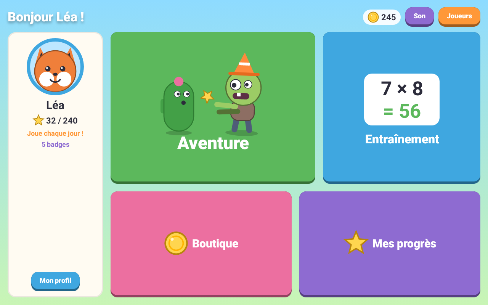
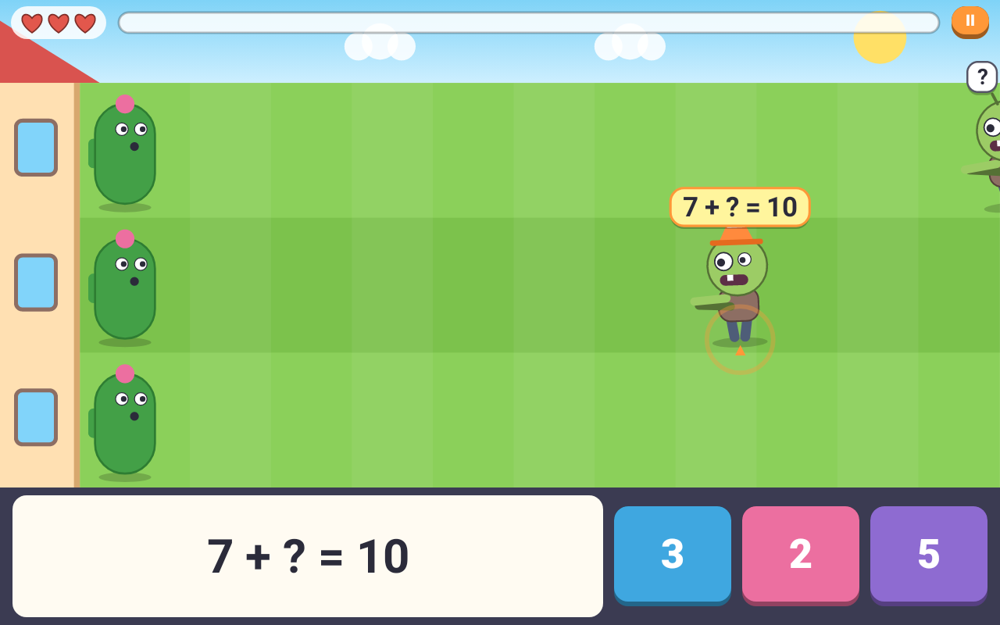
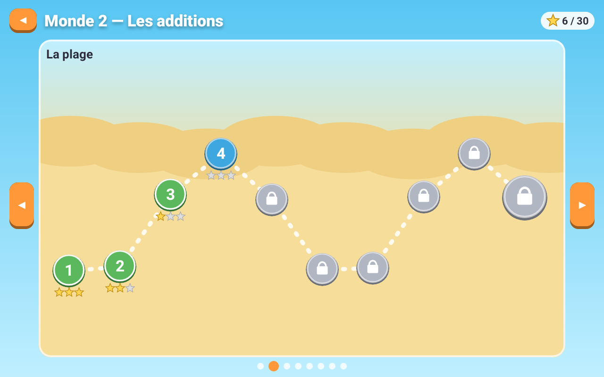
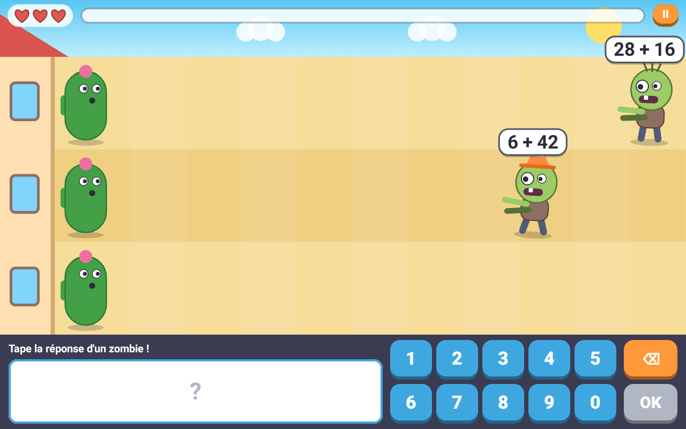
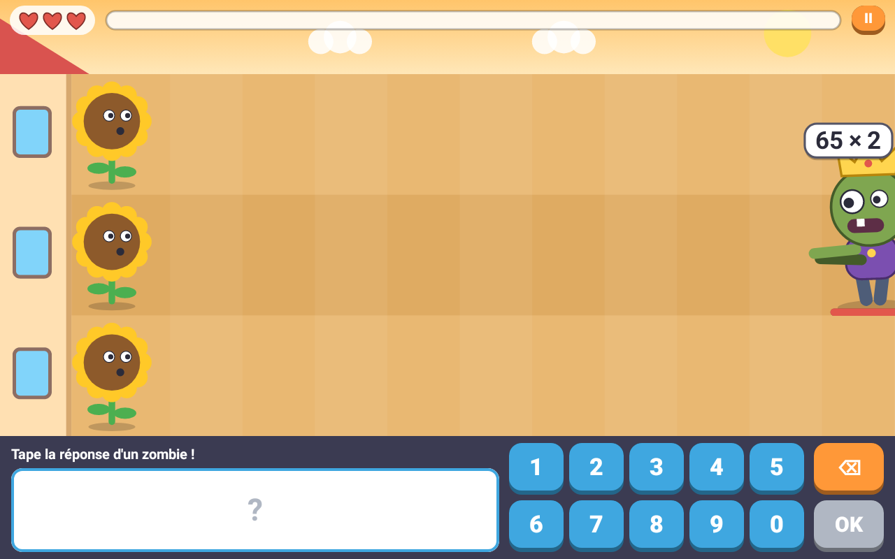
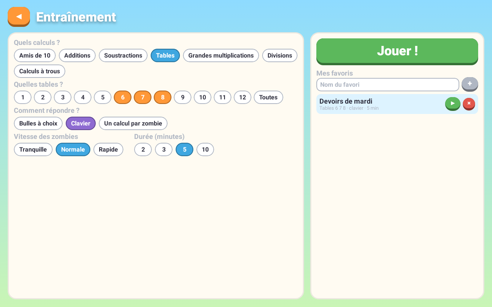
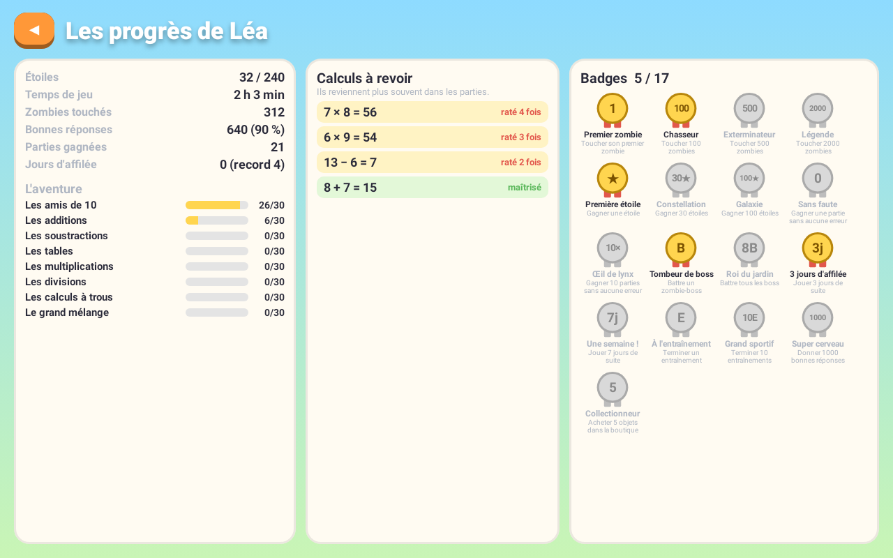
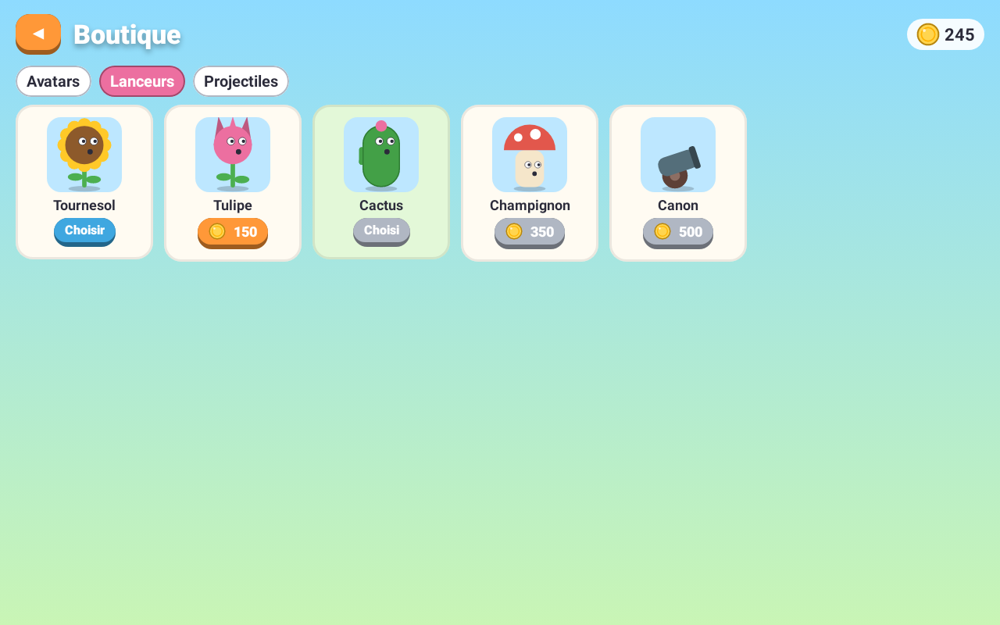

# Math contre Zombies

**Un jeu Android pour apprendre le calcul mental en s'amusant.** Des zombies rigolos marchent vers la maison : pour les arrêter, il faut trouver la bonne réponse au calcul qu'ils portent.

Pour les enfants de 5 à 11 ans (1re à 6e primaire). En français, sans publicité, sans connexion internet, gratuit.

<p align="center">
  
  
</p>

## Ce que l'enfant y trouve

### Une aventure en 8 mondes

Amis de 10 → additions → soustractions → tables → multiplications → divisions → calculs à trous → grand mélange. Chaque monde compte 10 niveaux de 2 à 3 minutes et se termine par un boss.

Dans chaque monde, la façon de répondre évolue : d'abord trois bulles à choisir, puis un clavier, puis un calcul différent sur chaque zombie.

<p align="center">
  
  
</p>

<p align="center">
  
</p>

### Pensé pour apprendre sans stress

- **Une erreur ne coûte rien.** On perd un cœur seulement si un zombie atteint la maison ; la solution est alors montrée et le calcul revient plus tard.
- **Les étoiles récompensent la précision, pas la vitesse.**
- **Les calculs ratés reviennent** dans les parties suivantes jusqu'à ce qu'ils soient maîtrisés.
- **Chaque enfant a son profil** : prénom, avatar, année scolaire (qui fixe le monde de départ) et vitesse des zombies (tranquille, normale, rapide).

### Entraînement libre

Les parents ou l'enfant choisissent exactement ce qu'on travaille : types de calcul, tables, mode de réponse, vitesse et durée. Les réglages peuvent être gardés en favoris, par exemple « Devoirs de mardi ».

<p align="center">
  
  
</p>

### Récompenses et suivi

Pièces à dépenser dans une boutique d'avatars, de lanceurs et de projectiles (purement décoratifs : rien n'y rend les calculs plus faciles), 17 badges, jours d'affilée. L'écran **Mes progrès** montre le temps de jeu, les étoiles, le taux de bonnes réponses et les calculs à revoir.

<p align="center">
  
</p>

## Installer l'application

L'application n'est pas sur le Play Store : on l'installe directement à partir d'un fichier APK.

**Il faut :** une tablette ou un téléphone Android 8.0 ou plus récent. Le jeu est conçu pour une tablette tenue à l'horizontale.

1. Sur la tablette, ouvrez la page de la **[dernière version](https://github.com/juliendevelopment/math-for-kids/releases/latest)**.
2. Dans la partie **Assets**, touchez **`MathContreZombies-vX.Y.Z.apk`** pour le télécharger.
3. Ouvrez le fichier téléchargé (depuis la notification ou l'application **Fichiers** › **Téléchargements**).
4. Android demande la première fois d'autoriser l'installation d'applications depuis votre navigateur ou votre gestionnaire de fichiers : touchez **Paramètres**, activez **Autoriser cette source**, puis revenez en arrière.
5. Touchez **Installer**, puis **Ouvrir**. Créez un profil par enfant, et c'est parti !

Si Google Play Protect affiche un avertissement (« application inconnue »), c'est normal pour une application installée hors du Play Store : choisissez **Installer quand même**. Une fois l'installation terminée, vous pouvez désactiver à nouveau l'autorisation de l'étape 4.

### Mettre à jour

Téléchargez et installez le nouvel APK de la même façon, par-dessus l'ancien : les profils, étoiles et pièces sont conservés. Le contenu de chaque version est décrit sur la page [Releases](https://github.com/juliendevelopment/math-for-kids/releases).

> ⚠️ **Désinstaller l'application efface toutes les données des enfants** (elles ne sont stockées que sur l'appareil et ne sont pas sauvegardées ailleurs).

### Vérifier le fichier (facultatif)

Chaque version publie un fichier `SHA256SUMS` à côté de l'APK. Sur un ordinateur :

```sh
sha256sum -c SHA256SUMS
```

## Vie privée

- **Aucune connexion internet**, aucune publicité, aucun achat intégré, aucun suivi ni statistique envoyés.
- **Aucune permission** demandée à l'installation.
- Les prénoms et les progrès des enfants restent sur l'appareil.

## Une question, un souci ?

Ouvrez une [issue](https://github.com/juliendevelopment/math-for-kids/issues) en décrivant l'appareil utilisé et ce qui s'est passé.

---

## Pour les développeurs

Kotlin + Jetpack Compose, un seul module `:app`. Tout est dessiné en code (aucune image) et tout le son est synthétisé (aucun fichier audio). Référence produit : `docs/BRIEF.md`. Règles pour les agents : `AGENTS.md`.

### Build

```sh
export ANDROID_HOME=$HOME/dev/apps/android-sdk
./gradlew testDebugUnitTest lintDebug assembleDebug assembleRelease
python3 -m unittest discover -s scripts -p 'test_*.py'
```

`ScreensTest` rend chaque écran sur une tablette 10" dans `app/build/screens/`. Les captures du README (`docs/screenshots/`) en sont des copies : les recopier après un changement visuel.

### CI et releases

- `.github/workflows/android-build.yml` : à chaque push sur `main` et PR — tests, lint, APK debug en artefact. Aucun secret.
- `.github/workflows/android-release.yml` : sur tag `android-vX.Y.Z`.
  1. Écrire `docs/releases/vX.Y.Z.md`.
  2. Commit sur `main`, push, attendre **Android Build** vert sur ce SHA exact.
  3. `git tag -a android-vX.Y.Z -m "…" && git push origin android-vX.Y.Z`.
  4. Le workflow vérifie que le commit est sur `main` avec build vert, calcule `versionCode = MAJOR*10000 + MINOR*100 + PATCH`, signe, vérifie l'APK (`scripts/check_android_apk.py` : certificat, package, version, SDK, alignement 16 Ko) et publie `MathContreZombies-vX.Y.Z.apk` + `SHA256SUMS`. Il refuse de remplacer une release existante.

### Signing

Clé dédiée : `~/agent-managed/keys/android/math-for-kids/` (`release.p12` + `signing.json`, 0700/0600), copiée dans les secrets du dépôt `SIGNING_KEYSTORE_BASE64`, `SIGNING_STORE_PASSWORD`, `SIGNING_KEY_ALIAS`, `SIGNING_KEY_PASSWORD`. Empreinte SHA-256 figée : `scripts/android-signing-cert.sha256`. **Perdre cette clé = plus de mise à jour possible sans désinstaller.** Ne jamais la réutiliser pour une autre app.

### Vérification sur appareil

À vérifier sur la tablette : lisibilité des calculs, vitesse des zombies pour chaque âge, clavier de saisie du prénom, son et musique, retour d'arrière-plan pendant une partie (pause automatique).
